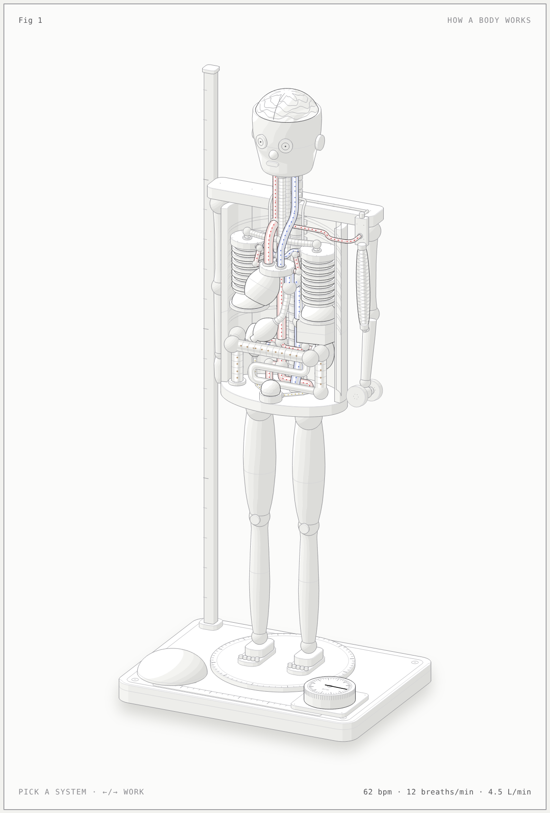

# How a body works: an anatomical automaton (interactive figure)

An explainer of how the human body works, built on request by an AI agent with the anatomy figure skill. It isn't drawn from one of my cases. The organs are drawn as machines, and one physiology model (`model.mjs`) drives every number and every motion. The values are typical textbook figures for a healthy adult, not measurements.

Open `human-body.html` (light) or `human-body-dark.html` in a browser.

## What is on the figure

| Body | Machine in the figure | What moves |
|---|---|---|
| Heart | a valve deck with four ports and a ventricle pump hung under it | squeezes every beat at the model's heart rate |
| Blood | red (oxygen-rich) and blue (oxygen-poor) pipes with tees and elbow fittings | marks flow with cardiac output; arterial marks surge with each beat |
| Lungs and diaphragm | two bellows standing on two diaphragm domes | domes pull down by about 3 cm per litre breathed in; bellows stretch |
| Brain and nerves | brain under the lifted skull cap, spinal cord to a junction on the shoulder yoke, phrenic nerves to the domes, a motor nerve to the arm | an impulse runs down the cord and phrenic nerves at every breath, and down the motor nerve before every curl |
| Muscle and bone | a jointed skeleton; the biceps is a braided artificial muscle (McKibben type) | it shortens to about 70 % of its rest length and fattens, and the forearm curls the dumbbell |
| Digestion | oesophagus, stomach, small intestine, colon with flexure fittings, liver, gall bladder | after **Eat a meal**: the stomach empties, glucose and insulin rise and fall |
| Kidneys | two filters with a hilum port each, ureters to a bladder tank | after **Drink 500 mL**: urine flow rises and the bladder fills, then empties |

Controls: the **Work** slider (or ←/→ on the figure) sets how hard the arm works. **Curl once**, **Eat a meal** and **Drink 500 mL** start an event. The six system buttons (or ↑/↓, 1–6, or a click on a part) light one system and show its live numbers in the panel; hovering previews one. **Zoom to the torso** frames the organs, and the page opens zoomed on phones. Left alone, an idle tour walks through the systems.

## Model (`model.mjs`)

- Work `e` from 0 to 1 scales O₂ uptake linearly from rest (250 mL/min, about 3.5 mL/kg/min at 70 kg) to an arm-work peak of 2.1 L/min. The figure works with one arm, and arm work peaks at about 70 % of a leg VO₂max of about 3 L/min.
- Heart rate rises linearly with O₂ uptake, from 62 to 176 beats/min. Stroke volume rises from 72 to 95 mL and plateaus at half of peak. Cardiac output is HR × SV (4.5 → 16.7 L/min). The O₂ taken out per litre of blood is VO₂ / CO (56 → 126 mL/L, with arterial content 200 mL/L).
- Breathing: 12 → 40 breaths/min. Ventilation is about 24 L of air per L of O₂, and it rises past about 60 % of peak (the ventilatory threshold). RER goes from 0.8 to 1.1.
- Systole lasts about 0.3 s and shortens a little with rate. The lung volume curve uses about 40 % of each breath for inhaling at rest.
- Digestion (hours): the stomach empties with a half-time of about 1.6 h. Glucose peaks about 45 min after a meal (5.0 → 7.6 mmol/L) and returns in about 2–3 h; insulin lags it.
- Kidneys: they filter 125 mL/min. Urine flow rises from about 1 to about 9 mL/min about 45 min after 500 mL of water. The urge comes at about 300 mL; the bladder holds about 500.
- Nerves: 70 m/s over about 0.95 m from motor cortex to biceps, so about 14 ms.

Time: the heartbeat and breathing run in real time. The response to a change in work settles in a few seconds here; in a real body it takes about a minute. Nerve impulses are slowed down so they can be followed. Digestion and the kidneys run 360× faster (1 s here is 6 min).

## Checks

- `node build.mjs --light --audit` ends `audit passed` (49 tubes, 202 solids, 303 items). It reports no pipe through anything, every pipe end on a mount, no fold, no self-overlap, and depth order 0 at rest. Two kinds of pair are excused in `build.mjs`:
  - by design: ball joints and parts seated in their host (`JOINTS`);
  - checked in 4× close-ups: lines that only touch on screen while being 7–28 units apart in depth, the nerves laid along the yoke, and the colon in front of the left shell panel (`ON_YOKE`, `SEEN`).
- `scripts/lines.mjs` on both pages: 0 floating line ends at rest.
- Not proved: the audit only sees the rest pose. The live parts are not recorded or audited in their other poses: the curling forearm, the dumbbell and muscle, breathed-in bellows and flattened domes, the pulsing heart, and the scaled bladder and stomach. Close-ups of a curl and a deep breath looked clean.

## Rebuild

`node build.mjs` writes `human-body-dark.html`; `node build.mjs --light` writes `human-body.html`. Add `--audit` to run the geometry audit. The build needs the figure kit from the anatomy skill, found at `~/.claude/skills/anatomy` or `$ANATOMY_DIR`. Viewing the HTML needs nothing.

Files: `model.mjs` (physiology), `build.mjs` (geometry, page), `live-geom.js` (parts rebuilt every frame, shared by the build and the page), `live.js` (the page's loop and controls).
