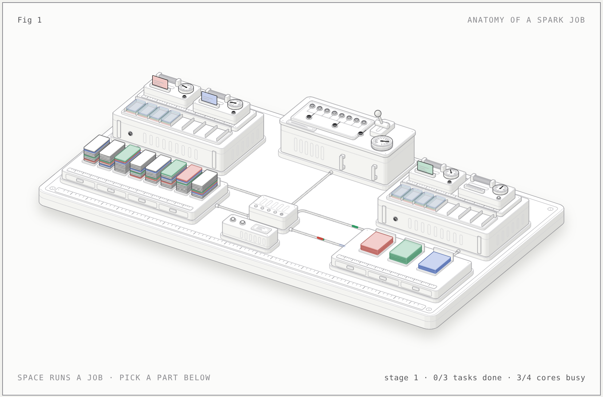

# Anatomy of a Spark job (interactive figure)

An explainer of what happens when one Spark action runs: the driver, the job, its stages and tasks, input and shuffle partitions, executors, cores, workers and the shuffle. An AI agent built it on request with the anatomy figure skill. It is not drawn from one of my cases. One small model (`model.mjs`) drives every number and motion in the figure.



Open `spark-job.html` (light) or `spark-job-dark.html` in a browser.

## The job it runs

```
spark.read.parquet("events/")          // 1 GB in 8 files of 128 MB
  .filter(col("type") === "click")     // narrow
  .repartition(3, col("user_id"))      // wide: a shuffle
  .write.parquet("clicks/")            // the action
```

## What is on the figure

| Spark | Part of the bench | What it does in the figure |
|---|---|---|
| Action → job | the lever on the driver console | Pulling it (Space) starts one job; it springs back when the last task reports |
| Driver | the console | Holds the lamp board; sends tasks and receives status updates over the network |
| Stages | the two lamp rows and the bus between them | 8 lamps for stage 0, 3 for stage 1; the bus lights when every stage 0 task has reported |
| Task | a lamp, a ticket standing in a core slot, the slot's dial | Ticket arrives over the cable; the dial sweeps once while the task runs |
| Input partition | a deck of 10 cards in the left shelf (1 card = 100 k rows) | Cards light top to bottom as the task streams them; the input stays in storage |
| Key buckets | card colours (grey = rows the filter drops) | Every input deck mixes all three; every output tray holds one |
| Worker | a chassis on the bench | Carries an executor and a local disk |
| Executor | the carrier plate with a heap strip | A JVM started for this application; two core slots each |
| Core (task slot) | a slot housing with roller, ticket clip, dial and busy lamp | One task at a time |
| Shuffle files | 3-card files in the local-disk rack | One file per map task, sorted by target partition; segments dim once fetched but stay on disk |
| Network | the switch and six cables | Packets: tickets (white/black), status (grey), input rows (grey or coloured), shuffle fetches and output writes (coloured) |
| Cluster manager | the small box in front of the switch | Started the executors; during the job it only tracks heartbeats |
| Output partitions | the three trays on the right shelf | One `part-` file per stage 1 task |

Controls: **Run the job** (Space), **Pause** (P), a speed slider. The eleven part buttons (or ←/→, 1–9, 0) light one part and explain it in the panel. Hovering a part on the bench previews it, and clicking selects it. Left alone, the figure runs the job, holds the result for about four seconds and runs it again.

## Model (`model.mjs`)

- **Input partitions.** The model follows Spark's `FilePartition` packing. With `maxPartitionBytes` 128 MB, `openCostInBytes` 4 MB and a default parallelism of 4 cores, it gets `bytesPerCore` = (1024 + 8·4) / 4 = 264 MB. The split size is min(128, 264) = 128 MB, which gives 8 partitions. The count comes out of the computation; it is not set by hand.
  - The count depends on the cluster, not only on the files. The same 1 GB gives 8 partitions on 2, 4 or 8 cores, 16 partitions on 16 cores (66 MB splits) and 32 on 32 cores.
- **Shuffle partitions.** There are 3, because `repartition(3, …)` names the count. Without it, `spark.sql.shuffle.partitions` (200) would apply, or whatever AQE coalesces it to.
- **Scheduling** is a discrete-event simulation:
  - The driver offers one task per executor per pass, so work spreads across executors. Spark shuffles the executor order at random; the model always starts with A.
  - A slot gets its next task only when the driver receives the previous task's status.
  - Stage 1 is submitted only after every stage 0 status has arrived.
  - With 8 tasks on 4 slots, stage 0 runs in two ragged waves. With 3 tasks, one slot idles in stage 1.
- **Shuffle read.** Each reduce task fetches its segment from all 8 map outputs. Remote requests go out first and local blocks are read while those are in flight, as in `ShuffleBlockFetcherIterator`. Here each executor ran 4 map tasks, so every reduce task reads 4 segments locally and 4 remotely.
- **Data.** The filter keeps 3 cards in 10 (30 %), one per key bucket: 8.0 M rows in, 2.4 M shuffled, 0.8 M per output file.
- **Time.**
  - Map tasks take 2.2–3.6 s and reduce tasks 3.0–3.8 s. That is plausible for 128 MB, but it is not measured.
  - Launches (0.5 s), status updates (0.45 s) and network transfers are slowed down; in a real cluster they take milliseconds.
  - The whole job takes 14.8 s of figure time.

## Simplifications and what the figure does not show

- **On default settings this code runs more jobs than the figure shows.** The figure draws the classic model: one action, one job, two stages.
  - With adaptive query execution (on by default since Spark 3.2), Spark SQL submits stage 0 as a map-stage job of its own (`submitMapStage` takes a new job ID). Stage 1 then runs as a second job that lists stage 0 as skipped.
  - `spark.read.parquet` without a schema runs a small job of its own before any action, to read one file's footer for the schema.
  - So on Spark 3.2+ defaults, the UI would show 3 jobs for this code: a schema read, the map stage and the result stage. The readout therefore says "job", not "job 0".
- **Shuffle file layout is idealised.** Exactly one card per key bucket per map task means no skew and no partial aggregation. Real shuffle files differ in size per segment, and one hot key makes one reduce task much longer.
- **Not drawn:**
  - data locality (object storage has none; HDFS does);
  - speculative execution, task retries and fetch failures (which resubmit the map stage);
  - dynamic allocation;
  - memory and spill;
  - the external shuffle service;
  - the driver collecting results (`write` tasks send back only commit messages and write statistics);
  - the job commit on the driver after the last task (`commitJob`, which writes `_SUCCESS`).
- **Shuffle files outlive the job.** Here they stay until the next run clears the bench. Spark keeps them until the shuffle is garbage-collected. Measured below: a second `collect()` on the same DataFrame skipped stage 0, while a second `write` or a `count` ran it again.
- **Shuffle fetches are drawn one packet per segment.** Spark groups blocks from the same executor into larger requests, up to `maxBytesInFlight`. Blocks of another executor on the same host are read from disk, not over the network.
- **Cluster manager role is simplified.** The heartbeat blink is decorative timing, not a Spark interval. Executors heartbeat to the driver (`spark.executor.heartbeatInterval`, 10 s by default), and workers heartbeat to the cluster manager.

## Fact check (2026-11-01, against the Spark 4.0.1 source)

Checked on request after the figure was built, in two ways: by reading the Spark v4.0.1 source on GitHub, and by running the figure's query on a real Spark 4.0.1 cluster (results in the next section).

| Claim in the figure | Verdict | Where it is in the source |
|---|---|---|
| Files are split at `maxPartitionBytes` (128 MB), each file costs `openCostInBytes` (4 MB), split size = min(maxPartitionBytes, max(openCost, total / defaultParallelism)), pieces packed largest first (next fit) | correct | `FilePartition.maxSplitBytes`, `getFilePartitions`; `DataSourceScanExec` (`sortBy(_.length)` reversed, total includes open cost) |
| defaultParallelism = total executor cores (here 4) | correct, min 2 | `CoarseGrainedSchedulerBackend.defaultParallelism`: `max(totalCoreCount, 2)` |
| 8 partitions for 1 GB in 8 × 128 MB files | correct for 2–8 cores only | same formula; 16 partitions at 16 cores. The text was fixed to say so |
| A finished task frees its core and the driver offers that executor the next task | correct | `CoarseGrainedSchedulerBackend`, `StatusUpdate` → `freeCores += taskCpus`, `makeOffers(executorId)` |
| Offers spread tasks across executors | correct; the order is random, not fixed | `TaskSchedulerImpl.shuffleOffers` = `Random.shuffle`; one task per offer per pass |
| Stage 1 starts only after every stage 0 output is registered | correct | `DAGScheduler`: child waits in `waitingStages` until `getMissingParentStages` is empty; map statuses registered via `mapOutputTracker.registerMapOutput` |
| One map output file per map task, sorted by target partition, reducers read contiguous regions | correct | `SortShuffleManager` class comment |
| Remote shuffle requests first, local blocks read while they are in flight | correct (remote order randomised; host-local blocks read from disk) | `ShuffleBlockFetcherIterator.initialize` |
| `repartition(3, col)` keeps 3 partitions under AQE | correct | `CoalesceShufflePartitions.supportedShuffleOrigins` excludes `REPARTITION_BY_NUM` |
| "One action, one job" | **incomplete**: AQE (default `true`) submits each shuffle stage as its own job | `ShuffleExchangeExec` → `submitMapStage`; `DAGScheduler.submitMapStage` takes a new job ID. Text fixed |
| Nothing runs before the action | **incomplete** for this code: Parquet schema inference runs a job | `ParquetUtils.inferSchema` → `mergeSchemasInParallel` → `parallelize(...).collect()`. Text fixed |
| The driver sends code with each task | **imprecise**: the stage's code is broadcast once per stage; the task message carries the partition and a reference to it | `DAGScheduler.submitMissingTasks`: `taskBinary = sc.broadcast(taskBinaryBytes)`. Text fixed |
| The job ends when the last task reports | **imprecise** for a write: the driver then commits the job | `FileFormatWriter`: `runJob(...)` then `committer.commitJob`. Noted above; not drawn |
| Defaults: shuffle partitions 200, `spark.task.cpus` 1, executor heartbeat 10 s, external shuffle service off | correct | `SQLConf.SHUFFLE_PARTITIONS`; `config/package.scala` |

## Measured on Spark 4.0.1 (`check-spark.py`)

The setup was `local-cluster[2,2,1024]`: two executor JVMs with two cores each, on one machine. The input was 8 Parquet files (800 k rows, 30 % clicks), read as 8 partitions. The query was the figure's. It ran once with AQE on (the default) and once with AQE off. Job, stage and task counts come from the Spark REST API.

| What | AQE on (default) | AQE off |
|---|---|---|
| `spark.read.parquet` without a schema | 1 job, 1 task | 1 job, 1 task |
| `filter` + `repartition` (no action yet) | 0 jobs | 0 jobs |
| `write` | **2 jobs**: map stage (8 tasks), then result (3 tasks, 1 stage skipped) | **1 job**, 2 stages, 11 tasks |
| Output | 3 `part-` files + `_SUCCESS` | same |
| Shuffle files on disk | 8 `.data` + 8 `.index` (one pair per map task) | same |
| Shuffle blocks read by stage 1 | 24 = 8 map outputs × 3 reducers (12 local + 12 remote in one run, 10 + 14 in another) | 24 (14 local + 10 remote) |
| Stage 1's first task launch vs stage 0's completion | 97 ms after | 35 ms after |
| Map tasks per executor | 4 + 4 in one run, 6 + 2 in another | 6 + 2 |
| Second `write` on the same DataFrame | stage 0 runs again (8 tasks) | stage 0 runs again (11 tasks in all) |
| `count()` on the same DataFrame | stage 0 runs again | stage 0 runs again |
| Second `collect()` on the same DataFrame | stage 0 **skipped**, 3 tasks | stage 0 **skipped**, 3 tasks |

What this settles:
- The figure is exactly right for AQE off: one action, one job, two stages, 8 + 3 tasks, one shuffle file pair per map task, 3 output files.
- With the default AQE on, the same write is two jobs. With the Parquet schema read, the code produces 3 jobs, as the source predicted.
- Stage 1 never started before stage 0 had finished.
- The input-packing model (`inputPartitions`) gave the same counts as Spark for three file sets: 8 files of 1 MiB → 8, 8 of 300 KiB → 4, and 2500/700/200/200/90 KiB → 5 (with `maxPartitionBytes` 1 MiB, `openCostInBytes` 32 KiB, 4 cores).
- Shuffle reuse is real but narrow. Only an action that reuses the DataFrame's physical plan (`collect()` again) skipped stage 0. `write` and `count` build a new plan and recompute it.
- **Task placement is not even.** The figure always gives each executor 4 of the 8 map tasks. The real runs split 4 + 4 once and 6 + 2 twice, depending on which executor was free first (tasks here took milliseconds, and executor start-up differs). How many shuffle reads are local follows from that placement.

Not measured: anything about real-size data (the input was a few MB) or a cluster across several machines.

## Experiments for the cases (`check-reuse.py`, `check-splits.py`)

Two small experiments test mechanisms that open questions in the cases depend on. Both ran on the same local 2 × 2 cluster on Spark 4.0.1. They test the mechanism on small synthetic data and say nothing about how large the effect was in the original jobs.

**Re-computation across writes** (`check-reuse.py`). A Python UDF stands in for an expensive parser and counts its own calls. One DataFrame (200 k rows) feeds two writes.

| Run | Parser calls | Time |
|---|---|---|
| batch, one write | 1.00 × rows | 3.1 s |
| batch, two writes, no cache | **2.00 × rows** | 2.9 s |
| batch, two writes, `persist()` first | 1.00 × rows | 2.3 s |
| `foreachBatch`, two writes, no cache | **2.00 × rows** | 6.7 s |
| `foreachBatch`, two writes, `persist()` first | 1.00 × rows | 4.3 s |

- Every write on an uncached DataFrame runs the whole lineage again, the parser included. Inside `foreachBatch` it is the same, and the Spark 4.0.1 guide says so too: each write "can cause the output data to be recomputed (including possible re-reading of the input data)", so cache the batch, write it to every location, then uncache it.
- The times are too small and noisy to mean anything; only the call counts are evidence.

**Splittable versus non-splittable files** (`check-splits.py`). The input was three 8 MiB text files and one 64 MiB text file, read once plain and once gzipped, with `maxPartitionBytes` 8 MiB.

| Read | Scan tasks | What each task read |
|---|---|---|
| text, plain | 13 | 8 MiB pieces; the 64 MiB file became 8 tasks |
| text, gzip | **4** | one task per file; the large file was one task (23 MiB compressed, 64 MiB of text) |
| `binaryFile`, gzip | 4 | one row and one task per file |

- A file that cannot be split, such as gzip or a whole file read as one record, is one task however large it is, so the largest file sets the stage's longest task. Its decompressed or parsed size lives in one task's memory, and an executor runs as many such tasks at once as it has cores, all in one heap. That last point is from how executors work; this experiment did not measure memory.
- The packing model predicts the 13 plain partitions exactly. Each file is a few bytes over 8 MiB, so the tails become tiny pieces packed into 2 extra partitions. The model has no notion of non-splittable files; for the gzip run it would wrongly predict 6.
- Task durations here are dominated by start-up: the first run's first wave took about 2 s per task against 0.2 s later.

## Related cases

The figure was not built from these cases. These are links where the lab's verified mechanics bear on a case's question; they are not evidence about what happened in those jobs.

- `cases/streaming-file-parser-rework.md`. The hypothesis "repeated evaluation multiplied parser work" has a confirmed mechanism: two writes from one uncached DataFrame ran the parser twice per row, in `foreachBatch` too (`check-reuse.py`). The lab does not separate the historical caching gain from the parser rewrite. For the driver-pressure question, these are the paths that do go through the driver: task status updates, the broadcast stage code, collected results, the write commit, and broadcast-join builds.
- `cases/productionizing-a-benchmark-driven-streaming-architecture.md`. "One binary file is the unit of parallelism" matches Spark's handling of non-splittable files (`PartitionedFileUtil.splitFiles`, `check-splits.py`). Because the cores of an executor share one heap, large-file tasks that run concurrently on one executor compete for the same memory. Batch sizes that track the master table's file layout fit the packing rule: each file costs an extra `openCostInBytes`.
- `cases/append-only-cdc-aggregation-pruning.md`. A broadcast join removes a shuffle stage boundary for the large side. With AQE, the map stage runs as its own job (measured above), which is the point where AQE can switch a join to broadcast using real sizes. Pruning also lowers the task count, because the split size is computed from the bytes left after pruning.
- `cases/repartitioning-large-delta-table.md` and `concepts/layout-follows-readers.md`. A table partition (a directory such as one `ingestion_date`) is not a Spark partition (one task's input). Spark sorts and packs the files of all selected table partitions together (`DataSourceScanExec`, `FilePartition`), so one task can read files from several dates, and one large file can be split across several tasks.
- `cases/databricks-cost-intelligence-loop.md`. Idle slots are paid capacity: stage 1 here keeps 1 of 4 cores idle. Busy core-seconds over paid core-seconds, from task metrics, is a candidate right-sizing signal.
- `cases/unified-data-observability-and-lineage.md`. Spark job IDs are not a stable identity: the same write was 1 or 2 jobs depending on AQE, after a schema-read job. That supports keying telemetry on `query_id` and `batch_id`.

## Checks

- `node build.mjs --audit` ends `audit passed`: 6 cables, 326 solids, 361 items, 0 problems in every check.
- `scripts/lines.mjs` reports 0 floating line ends on both pages: at rest, in stage 1 and after the job.
- Captures were checked in both themes, at 390 px, with a focused part, with reduced motion (which shows the finished job), and at 4× over the worker, the driver console and the shuffle rack.
- **Not proved:** the audit sees only the rest pose. The lever is recorded only at rest; it is rebuilt each frame in the page.

## Rebuild

`node build.mjs` writes `spark-job.html`, and `node build.mjs --dark` writes `spark-job-dark.html`; add `--audit` to run the geometry audit. The build needs the figure kit from the anatomy skill, found at `~/.claude/skills/anatomy` or `$ANATOMY_DIR`. Viewing the HTML needs nothing.

Files: `model.mjs` (the job and its schedule), `build.mjs` (geometry and page), `live.js` (the page's loop, packets and controls), `check-spark.py` (the measurement above), `check-reuse.py` and `check-splits.py` (the experiments for the cases).

To rerun the measurement, unpack Spark 4.0.1 (`spark-4.0.1-bin-hadoop3`), set `SPARK_HOME`, put `$SPARK_HOME/python` and the bundled py4j zip on `PYTHONPATH`, and run `python3 check-spark.py true` (AQE on) or `false`, `python3 check-reuse.py` or `python3 check-splits.py`. They need Java 17 or 21 and write under `/tmp/spark/`.
